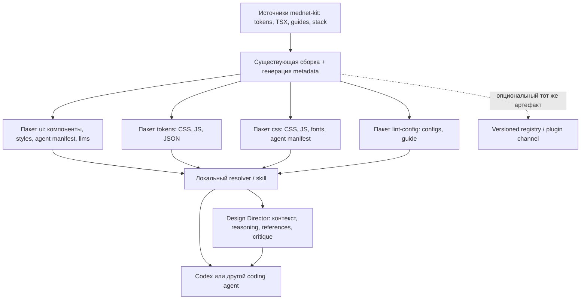

# План интеграции mednet-kit с агентами и Design Director

Дата: 4 ноября 2026 года. Основание: [аудит](DESIGN_SYSTEM_AUDIT.md) и [предложение](DESIGN_SYSTEM_PROPOSAL.md).

Статус: **архитектурное предложение**. Имена новых файлов, exports, CLI и форматов ниже ещё не реализованы и не утверждены. Команды приведены как целевой интерфейс; выполнять их сейчас не следует. Репозиторий/реализация Design Director не предоставлены, поэтому его сторона контракта проектируется по описанной пользователем ответственности.

## 1. Архитектурный выбор

Рекомендуется расширить существующую package-based поставку. Значения и implementation knowledge остаются в ките; небольшой локальный skill обнаруживает установленную версию и загружает нужные фрагменты. Design Director получает тот же контракт как дополнительный потребитель. Сервис знаний, обязательный MCP и отдельная база токенов для этого не нужны.



Граф описывает зависимости знаний, а не обязательный вызов Director перед каждым изменением. Кит пригоден без него, без сети и без CLI после установки нужных артефактов.

## 2. Что переиспользовать

| Уже существует                                   | Использование в целевой архитектуре                                                                                           |
| ------------------------------------------------ | ----------------------------------------------------------------------------------------------------------------------------- |
| `@mednet/tokens/tokens.json`, JS/CSS exports     | Сохранить значения и существующий формат; manifest только указывает источник/формат/версию                                    |
| DTCG color source + base.ts + emit.ts            | Продолжать генерировать из них, без второго token engine/Style Dictionary по умолчанию                                        |
| `.d.ts` и build-llms.mjs                         | Использовать тот же перечень экспортов и TypeScript program для component metadata                                            |
| `stack.json` + stack.mjs                         | Сохранить библиотечную карту; обернуть ссылкой из versioned manifest, не переписывать её вручную для Director                 |
| `docs/agent-guide/*.md`, пакетные llms источники | Канонический текст правил; выдавать llms и небольшие topic-фрагменты из тех же файлов                                         |
| Внешний playground gen-api.mjs и api-ru.json     | До нового extractor согласовать A6: переиспользовать extraction/default logic и локализацию, а не реализовывать второй парсер |
| lint-config                                      | Ссылки на существующие проверки; doctor не создаёт второй lint engine                                                         |
| Changesets fixed versions и release pipeline     | Версионировать knowledge вместе с пакетами; не отдельный независимый knowledge latest                                         |
| Upstream shadcn docs/search/skills/registry      | Использовать для upstream API/retrieval, не копировать их возможности в mednet CLI                                            |

Сначала пригоден ручной путь из текущего README: ссылка на установленный llms в AGENTS.md. Он остаётся fallback для старых версий и проектов без установки skills. Новый контракт не должен делать старые packages неработоспособными.

## 3. Владение источниками и размещение

### 3.1. Пакетные артефакты

Предлагаемые exports и содержимое; все пути `dist/agent/*` — **новые generated artifacts**, не существующие файлы:

| Владелец         | Предлагаемый артефакт                                          | Канонический источник                                                      |
| ---------------- | -------------------------------------------------------------- | -------------------------------------------------------------------------- |
| `@mednet/tokens` | `./agent/manifest.json`                                        | package.json, emit.ts, semantic/base sources                               |
| `@mednet/tokens` | Существующий `./tokens.json`                                   | emit.ts; не дублировать значения в ui metadata                             |
| `@mednet/ui`     | `./agent/manifest.json`                                        | package.json + экспортируемые артефакты сборки                             |
| `@mednet/ui`     | `./agent/components.json`                                      | TS declarations, привязанные CVA/defaults, ручная metadata смысла          |
| `@mednet/ui`     | `./agent/rules.json`, `./agent/patterns.json`                  | Индексы существующих guides и одобренных kit-specific рецептов             |
| ui/css/tokens    | Topic guides/examples, доступные по manifest-relative paths    | Общие MD источники и проверенные примеры; сгенерированные представления    |
| `@mednet/css`    | `./agent/manifest.json`, HTML component/recipe knowledge       | Собственный HTML API Basecoat и overrides; не React props                  |
| `@mednet/css`    | `dist/agent/tokens.snapshot.json`, если требуется offline JSON | Снимок того же token build, который встроен в CSS; generated, с provenance |
| lint-config      | Действующие config exports и llms; manifest optional позже     | Существующие eslint.js/stylelint.js и общая справка                        |

Важное отличие: `@mednet/css` использует tokens/ui как **devDependencies сборки**, а не как runtime dependencies потребителя. CSS-only проект не обязан иметь `@mednet/tokens` или React. Его metadata должна указывать на встроенный snapshot либо явно доступный versioned pack; resolver не должен требовать отсутствующую транзитивную зависимость. У ui tokens — runtime dependency, поэтому доступен внешний token export через package context.

Для новых exports обновить `files`, `check-dist.mjs`, package tests и sources guides. Не публиковать внутренние scripts/исходники целиком ради чтения одного JSON. Не делать wildcard export в ui, который случайно сопоставит agent JSON с `dist/components/*.js`.

### 3.2. Единственный источник каждой части

- API и реальные допустимые значения: собранные типы/экспорты; defaults, заданные китом, сверяются с текущим исходником/emit. Inherited default помечается отдельно, а неизвестный остаётся null.
- Цвета/размеры tokens: существующие генераторы. Component heights могут фиксироваться как derived facts с sourceRef, но не становятся второй редактируемой token table.
- Текст правила: общий или пакетный guide; structured index хранит ID, область, уровень, ссылку и способ проверки. Если JSON содержит текст, он генерируется из того же блока MD, не редактируется параллельно.
- Pattern: kit-specific состав, доступные imports, обязательные состояния и ссылки на правила. Design Director выбирает, подходит ли pattern задаче.
- Ручная semantic metadata нужна для «когда применять», accessible obligations, anti-patterns, browser exceptions. Эти сведения нельзя надёжно вывести только из TypeScript.

Разумная начальная гранулярность — один components.json и несколько guides. Разбивка на файл для каждого prop, отдельный registry database и retrieval service не требуются. Разделять файлы дальше только при измеренной цене контекста.

## 4. Data contract v1 — предлагаемая структура

### 4.1. Manifest

UTF-8 JSON, contract SemVer и schema URL/version. Schema хранится и выпускается из кита; URL не требуется скачивать во время обычного чтения. Пример описывает текущий baseline 2.1.0 в **будущем формате** — такого export у 2.1.0 сейчас нет:

```json
{
  "schemaVersion": 1,
  "contractVersion": "1.0.0",
  "kit": {
    "id": "mednet",
    "package": "@mednet/ui",
    "version": "2.1.0",
    "surface": "react"
  },
  "capabilities": ["tokens.resolved-json", "components.metadata", "rules.index", "patterns.index"],
  "artifacts": {
    "tokens": {
      "package": "@mednet/tokens",
      "export": "./tokens.json",
      "format": "mednet-resolved-tokens"
    },
    "components": "./components.json",
    "rules": "./rules.json",
    "patterns": "./patterns.json",
    "overview": "../../llms.md",
    "stackExport": "@mednet/ui/stack.json"
  },
  "compatibility": {
    "react": "^19.2.0",
    "tailwindcss": "^4.3.0",
    "minimumAgentContract": "1.0.0"
  }
}
```

Здесь `components/rules/patterns/overview` — пути относительно самого manifest, разрешаемые только внутри package root. Допустимый `../../llms.md` из `dist/agent` остаётся внутри пакета; проверять нужно итоговый realpath, а не запрещать любые `..` механически. Cross-package references разрешаются через declared package/export, а не через произвольный абсолютный filesystem путь.

При выпуске добавляются provenance: точный packageVersion, source commit при наличии, список artifact digests и версии зависимостей, влияющих на extraction. Для digest manifest не хеширует сам себя; package tarball integrity фиксируется снаружи в lock. Не включать в артефакт timestamp, абсолютные локальные пути или случайный build ID, которые нарушат воспроизводимость.

Contract v1 обязан описывать обязательные поля manifest, допустимые surface (`react`, `html`, `tokens`), форматы artifact refs, правило digest и поведение при unknown fields/capabilities. Нельзя объявить совместимость только по имени `mednet`.

### 4.2. Component metadata

Пример **нового формата**, значения варианта/размера взяты из текущего Button:

```json
{
  "schemaVersion": 1,
  "packageVersion": "2.1.0",
  "components": [
    {
      "id": "button",
      "import": "@mednet/ui/button",
      "exports": ["Button", "buttonVariants"],
      "parts": [
        {
          "export": "Button",
          "element": "button",
          "props": {
            "variant": {
              "values": ["default", "outline", "secondary", "ghost", "destructive", "link"],
              "default": "default",
              "source": "kit"
            },
            "size": {
              "values": ["default", "xs", "sm", "lg", "icon", "icon-xs", "icon-sm", "icon-lg"],
              "default": "default",
              "source": "kit"
            }
          }
        }
      ],
      "ruleRefs": ["mednet.composition.base-ui-render", "mednet.a11y.accessible-name"],
      "patternRefs": ["mednet.pattern.action-feedback"],
      "sourceRefs": ["packages/ui/src/components/button.tsx"],
      "upstream": {
        "library": "@base-ui/react",
        "docs": "https://base-ui.com/react/components/button"
      }
    }
  ]
}
```

Эти rule/pattern IDs пока предлагаются, не являются существующими anchors. Полная metadata дополнительно различает public parts, helper values/types/hooks, controlled/uncontrolled props, собственные и inherited defaults, known states, client/provider needs, browser limitations, examples refs. Не нужно разворачивать весь DOM API в каждый JSON: common/native/inherited API можно ссылать отдельно.

`element` — default element, не гарантия семантики после `render`. `known states` — что поддерживается, не сертификат accessibility. `sourceRefs` пригодны для сопровождения; consumer не обязан иметь source TSX. Обязательная executable информация должна читаться из поставленного артефакта.

Extractor должен связывать CVA с конкретной экспортируемой частью: `InputGroupButton.size` не равен `InputGroup.size`, Sidebar имеет несколько разных size API. Значения, которые нельзя достоверно связать, нельзя публиковать как default. Эту проблему уже учитывает playground extractor.

### 4.3. Rules и patterns

Rules index minimum:

```json
{
  "schemaVersion": 1,
  "rules": [
    {
      "id": "mednet.composition.base-ui-render",
      "level": "must",
      "scope": ["react", "composition"],
      "guide": "guides/ui-setup.md#composition",
      "checks": ["typecheck", "manual-semantics"]
    },
    {
      "id": "mednet.a11y.accessible-name",
      "level": "must",
      "scope": ["react", "html", "a11y"],
      "guide": "guides/ux.md#accessible-names",
      "checks": ["browser-accessibility", "manual-keyboard"]
    }
  ]
}
```

Guides/anchors в примере — будущие generated topic files. Уровни M/S существующей справки отображаются в must/should; новый level нельзя угадать по тону prose. Для правил, где есть исключения, index ссылается на полный блок, не обрезанный slogan.

Pattern record: `id`, `surface`, `purpose`, `parts`, `ruleRefs`, `requiredStates`, `exampleRefs`, `verification`, `sourceRefs`. Начальный набор: field-with-error, form-error-summary, searchable-list, dashboard-metric, public-page, destructive-confirmation, action-feedback. Значения и props в примерах выводятся/проверяются на той же версии пакета. Обычная page composition не должна становиться новым обязательным wrapper component.

Anti-patterns включают: `asChild` вместо render; копирование TSX в consumer; чужой UI primitive; raw colors; выдуманный Input size/density; глобальный font-mono ради цифр; ошибка только цветом; pending вместо empty; Table как будто он содержит сортировку/виртуализацию; изменение стилей компонента через запрещённый className override. Ссылки ведут к существующим правилам и конкретному безопасному способу выполнить задачу.

### 4.4. Пример знания о композиции

Ниже иллюстративный пример для будущего pattern pack, а не новый файл компонента. Он показывает существующий API и явные связи. Управление состоянием, submit и server validation остаются у приложения.

```tsx
import { Field, FieldLabel, FieldDescription, FieldError } from '@mednet/ui/field';
import { Input } from '@mednet/ui/input';

export function OrganizationField({ error }: { error?: string }) {
  const description = ['org-hint', error ? 'org-error' : null].filter(Boolean).join(' ');

  return (
    <Field data-invalid={Boolean(error)}>
      <FieldLabel htmlFor="org">Наименование организации</FieldLabel>
      <Input
        id="org"
        name="organization"
        aria-invalid={Boolean(error)}
        aria-describedby={description}
      />
      <FieldDescription id="org-hint">Укажите полное наименование.</FieldDescription>
      {error ? <FieldError id="org-error">{error}</FieldError> : null}
    </Field>
  );
}
```

Для повторяемого блока `id` передаётся или генерируется через useId в соответствующей клиентской композиции; пример выше предназначен для одного поля. В full-form recipe отдельно нужны noValidate, обязательность доступным текстом, проверка при отправке, summary и управление focus. Не следует выдавать этот fragment за готовую форму.

## 5. Codex skill: discovery и загрузка

Официальная документация подтверждает `SKILL.md` с name/description и repo discovery `.agents/skills` от cwd до root. Метаданные загружаются сначала, тело/ресурсы — по необходимости. Symlink поддерживается, но в предлагаемом installer по умолчанию копия: она переносима между Windows, CI и checkout. Изменения обнаруживаются автоматически; при проблеме можно перезапустить Codex. Для более широкой distribution OpenAI также описывает plugins. [Build skills](https://learn.chatgpt.com/docs/build-skills).

Предлагаемая структура установки:

```text
<repo>/
  .agents/skills/mednet-kit/
    SKILL.md
    scripts/resolve-kit.mjs
  .mednet/agent-lock.json
  AGENTS.md                   # изменяется только по выбранному режиму интеграции
```

Skill — один workflow загрузки знаний. Он не содержит копии значений tokens, большого списка props или универсальной методологии дизайна.

Для ручной установки в Codex уже есть `$skill-installer`; отдельный kit CLI не должен заменять каталог skills или общий GitHub installer. Его дополнительная задача — привязка к локальной версии пакетов, ownership синхронизации и kit-specific doctor. Если достаточно стандартной ручной установки loader, R5 можно отложить, сохранив R3/R4. Вызов стороннего installer через незакреплённый `latest` не должен быть скрытым шагом команды кита.

Возможный front matter:

```yaml
---
name: mednet-kit
description: Use when building, changing, or reviewing interfaces that use installed @mednet/ui, @mednet/css, or @mednet/tokens. Load the installed kit rules and APIs; do not use for unrelated projects.
---
```

Краткое тело должно выполнять следующее:

1. Прочитать действующие инструкции проекта; определить изменяемое приложение/файлы, а не только корневой cwd.
2. Найти kit packages и их версии из project context. Resolver использует package.json и package resolution, читает JSON/тексты, не импортирует React root и не исполняет чужие конфиги.
3. Прочитать manifest совместимой версии. Для старых версий — явно ограниченный fallback на установленный llms/package exports, без выдумывания metadata.
4. Загрузить setup/brand и применимые обязательные UX-правила, затем только нужные components/patterns. За полным inherited API обратиться к указанной библиотеке установленной версии.
5. Собирать UI из существующих exports. При пробеле в kit API сообщить его; не маскировать внешний компонент как существующую возможность кита.
6. Проверить изменённый сценарий применимыми существующими линтерами/типами/сборкой и browser checks. Не объявлять отсутствующий job выполненным.

`resolve-kit.mjs` — read-only helper на Node built-ins, общий код с resolver CLI при сборке. Skill не должен скачивать latest CLI во время каждого использования. После npx-install CLI может отсутствовать локально; helper и чтение manifest должны продолжать работать.

### Monorepo и resolution

- Идентичность — declared package и разрешённый `package.json` из контекста приложения, не предположение `repo/node_modules/@mednet/ui`.
- Для npm/pnpm использовать resolution от абсолютного `apps/web/package.json` (например, createRequire); ui-dependent token refs — из контекста найденного ui package.
- Отличать публично выбранную surface от случайно hoisted/transitive package. CSS-only не активирует React-предписания только потому, что ui есть где-то в workspace.
- Один root skill может обслуживать несколько приложений. Lock содержит project-relative roots и версии; при двух разных kit versions target выбирается по изменяемому приложению. Если цель не определена и выбор существенен — запросить выбор, а не взять первый package.
- Если Codex запущен в root, skill в глубоком `apps/web/.agents/skills` не обязательно будет обнаружен. Поэтому по умолчанию установка root skill с routing по project context; `--scope project` для leaf — осознанный вариант с объяснением границ discovery.
- Yarn PnP требует проверки запуска в его resolver context; MVP не должен заявлять поддержку PnP по одному наличию `yarn.lock`.

### AGENTS.md

Codex читает проектные AGENTS по пути root→cwd; `AGENTS.override.md` имеет приоритет в своей директории, а размер цепочки ограничен (по умолчанию 32KiB). Следовательно, нельзя вклеивать весь llms в AGENTS или считать, что block в игнорируемом AGENTS всегда действует. [AGENTS.md](https://learn.chatgpt.com/docs/agent-configuration/agents-md).

Предлагаемый default install создаёт собственные skill/lock и **показывает небольшой patch/snippet** подключения для AGENTS. Режим `--instructions=managed-block` явно разрешает добавить/обновить только свой именованный блок. Он не заменяет существующий файл, не создаёт override и не меняет глобальную конфигурацию Codex.

Block содержит ссылку на skill/resolver и требование читать справку разрешённого package context. Числа, цветовые значения, полные UX-рецепты туда не копируются. Если соответствующая ссылка уже есть, doctor считает интеграцию присутствующей; нельзя добавлять одинаковую инструкцию ещё раз. Наличие override/локального запрета показывается как конфликт применимости.

## 6. CLI: целевой developer experience

Отдельного kit CLI сейчас нет. Если A1 принят, минимальный новый пакет — `packages/cli`, имя `@mednet/cli`, bin `mednet`; без React/runtime UI зависимостей и без генератора приложений. Имя требует проверки доступности при реализации. Старые планы create-app не дают основания использовать отсутствующий код.

Команды ниже **предлагаются**, `X.Y.Z` означает точную совместимую версию после её выпуска:

```bash
npx @mednet/cli@X.Y.Z agent install codex
npx @mednet/cli@X.Y.Z agent install codex --project apps/web --dry-run
npx @mednet/cli@X.Y.Z agent sync
npx @mednet/cli@X.Y.Z doctor
npx @mednet/cli@X.Y.Z doctor --json
```

| Команда P           | Назначение                                                                                     | Что не входит в её side effects                                                       |
| ------------------- | ---------------------------------------------------------------------------------------------- | ------------------------------------------------------------------------------------- |
| agent install codex | Обнаружить surface/version, проверить совместимость, установить loader и ownership lock        | Не устанавливает/обновляет UI dependencies, не меняет styles, не запускает shadcn add |
| agent sync          | Сопоставить installed versions и lock; обновить только принадлежащие installer файлы/refs      | Не изменяет package.json/lockfile менеджера пакетов, не подтягивает latest kit        |
| doctor              | Read-only diagnosis для versions, exports, styles/fonts hookup, lint integration и skill drift | Не применяет fixes, не публикует, не исполняет конфиги или package scripts            |
| --dry-run           | Показать точные paths, provenance, diff и конфликты                                            | Ноль записей, включая lock/cache проекта                                              |

Npx может обращаться к npm для получения самого CLI; это явное действие разработчика. Повседневное чтение skill и default doctor не требуют сети. Если CLI установлен как devDependency, `pnpm exec mednet ...` даёт более воспроизводимый локальный путь. Установка этой devDependency — отдельное действие разработчика, не скрытый результат agent install.

### 6.1. Общий план безопасной операции

1. Discover roots/packages и действующие локальные ограничения. Подготовить plan без mutation.
2. Проверить schema, совместимость, source integrity, file destinations и ownership. Заранее обнаружить все конфликты.
3. Сравнить существующие bytes/hash с записанным installer baseline. Отсутствие lock не является разрешением перезаписи.
4. При отсутствии конфликтов записать временные файлы внутри целевой области, затем заменить подготовленным набором. Lock фиксировать после файлов. При сбое восстановить изменённые собственные bytes; операция должна распознавать незавершённое состояние при следующем запуске.
5. Повторный запуск с теми же входами — no-op: те же bytes, без дублирования blocks, без timestamp churn.

Не обещать атомарность нескольких файлов одним rename: это не универсальная filesystem гарантия. Нужен staging и восстановление/идентификация partial state, соразмерные небольшому количеству файлов.

Проверять resolved destination и junction/symlink/reparse-point выходы за разрешённый root. Не писать через неожиданную ссылку и не заменять её автоматически. При registry input запрещены абсолютные пути, arbitrary executable hooks и выход за разрешённые назначения. Пути к общим пользовательским/global skills по умолчанию не затрагиваются.

### 6.2. Ownership, lock и конфликты

Один `.mednet/agent-lock.json` достаточен для MVP: project roots, selected surface, resolved package versions, contract version, loader version, source/integrity, digest установленных собственных файлов и управляемого блока. Не создавать одновременно несколько конкурирующих config/lock файлов без реальной необходимости.

| Ситуация                                          | Действие sync                                                                     |
| ------------------------------------------------- | --------------------------------------------------------------------------------- |
| Файл принадлежит installer, hash совпадает        | Можно обновить по совместимой версии                                              |
| Файл уже равен желаемому, lock отстал             | Согласовать ownership запись без изменения bytes                                  |
| Файл изменён человеком                            | Остановить весь применяемый plan, показать diff/конфликт, сохранить bytes         |
| Существующий одноимённый skill без lock           | Не присваивать/переписывать; предложить явное принятие после сравнения            |
| Неизвестный schema major или несовместимый loader | Не обновлять; объяснить, какая версия нужна                                       |
| Удалён принадлежащий installer файл               | Показать восстановление в plan; не считать молча новой пользовательской политикой |
| Повреждён/противоречив lock                       | Read-only diagnosis; без небезопасного «reset всего каталога»                     |

Default `--force` с обходом ownership не нужен. Отдельная явно выбранная replace/reconcile операция возможна позже, с конкретным diff и сохранением пользовательской версии. Это не требуется для первого MVP.

### 6.3. Doctor: состав и пределы

Проверять:

- Разрешаемые package versions и public exports; отсутствующий manifest для старой версии — поддержанный legacy mode, а не повод устанавливать latest.
- Совместимость components/types/manifest, наличие referenced artifacts и digests, смешение версий и неподдерживаемые surfaces.
- Статические свидетельства подключения styles, fonts из кода и legacy PostCSS plugin там, где проект заявляет Chrome109. Если конфигурация динамическая, результат `unknown`, а не ложный pass.
- Наличие lint-config и явных связей его подключения; не утверждать effective ESLint rules по одному текстовому import, когда проект может их переопределить.
- Skill discovery scope, duplicate skill names, active AGENTS/override и managed block drift.
- Состояние ownership, устаревший loader и offline snapshot.

JSON result P: `schemaVersion`, `status` (`pass`, `warn`, `fail`), `projects`, `checks[]` с `id/status/evidence/message/remediation`. Evidence — пути/версии/имена exports, без чтения секретов и без вывода env. Предлагаемые exit codes: 0 — нет blocking failures, 1 — проблемы установки/совместимости, 2 — ошибочные аргументы/невалидная конфигурация; warnings в JSON видны отдельно.

Doctor **не доказывает** WCAG, качество визуальной композиции, реально использованный webfont, работающий focus, доступность данных графика и совместимость браузера. Для них он указывает конкретную требуемую проверку. Сам lint/build он по умолчанию не запускает: scripts могут иметь произвольные side effects.

## 7. Distribution: package, registry, plugin

### 7.1. Package-based — первый канал

Пакеты несут metadata/knowledge своей версии; CLI несёт небольшой Codex loader и resolver template. Нейтральные правила не принадлежат CLI: версия loader не меняет значения кита. CLI входит в общий release process после решения владельца; не требует изменения существующих пакетов потребителя при sync.

Для legacy версии без manifest: чтение llms + package exports, doctor сообщает limited metadata. Нельзя генерировать якобы авторитетный новый manifest из live latest docs и подписывать его старой версией.

### 7.2. Registry-based — дополнительный совместимый канал

Различать npm registry (уже используется) и shadcn custom registry (пока отсутствует). Для CDN-only/без node_modules можно распространять **тот же versioned knowledge pack**, с manifest, guides, metadata и integrity. Такому проекту нужен явный выбор версии/surface; из major CDN URL `@2` нельзя надёжно вывести точный установленный patch.

Если нужен shadcn registry, использовать его стандартный формат `registry:file` с фиксированными project targets для knowledge snapshot, без `registry:ui` копий меднет-компонентов и без dependencies, устанавливающих второй kit. Upstream уже умеет registry discovery/build/fetch; отдельный mednet registry server/search engine не нужен. Схема `registry:file` требует target, но не гарантирует ownership/idempotence управляемых инструкций — эти проверки остаются у kit installer. [registry-item.json](https://ui.shadcn.com/docs/registry/registry-item-json).

Registry pack должен генерироваться из того же kit build, а не вручную из playground. Контент можно размещать как versioned static artifact в существующем сайте, если владелец согласует публикацию и сопровождение. Digest и exact version фиксируются в lock; сеть разрешается явным выбором registry source, не скрытым fallback default sync. Нельзя обновить styles до другой версии лишь потому, что registry metadata новее.

### 7.3. Plugins и другие агенты

Codex plugin — возможная упаковка того же loader, особенно для пользовательского распространения через каталог. Он не меняет ownership правил и не требует MCP. Это альтернатива/дополнение project-local skill, не обязательная новая зависимость MVP.

Другие coding agents получают тот же neutral manifest/guides, но отдельный небольшой adapter под свои discovery paths и instruction integration. Не раскладывать один Codex-specific SKILL во все известные каталоги автоматически. Каждый adapter имеет свою проверенную capability matrix.

## 8. Версии и совместимость

Разделить четыре понятия:

| Версия                 | Назначение                                                                              |
| ---------------------- | --------------------------------------------------------------------------------------- |
| Package/kit SemVer     | Реальные tokens/components/styles и knowledge bundle соответствующего релиза            |
| Contract SemVer        | Поля/семантика manifest/components/rules/patterns и способы resolution                  |
| Loader/adapter version | Возможности установки и чтения формата конкретным агентом                               |
| Consumer lock          | Фактически разрешённый набор versions/digests/project roots, не ещё одна версия дизайна |

Packages сейчас выпускаются фиксированной группой, но у потребителя могут быть разные установленные patch/minor. Doctor обязан показать разрешённый набор и проверить declared ranges/manifest compatibility, а не только равенство major или желание CLI быть latest. Для точного воспроизводимого baseline рекомендуется совпадающий kit release; допустимые комбинации должны быть явно протестированы и объявлены. Самовольное обновление зависимостей при несовпадении запрещено.

Внутри одного schema/contract major reader может игнорировать добавленные необязательные поля. Неизвестная required capability или несовместимое изменение значения поля — fail до записи. Удаление/переименование rule/pattern ID требует migration map или breaking contract; старые ID не переназначаются другому смыслу.

Публичное добавление metadata/exports — обычно additive minor по правилам проекта; исправление метаданных — patch при сохранении совместимости. Изменение существующего вида бренда — major, даже если JSON schema не меняется. Включение нового пакета/первую публикацию и изменения release.yml согласовывает владелец; локальный audit не даёт разрешения на публикацию или merge Version PR.

## 9. Контракт с Design Director

### 9.1. Граница ответственности

| Область                                             | UI Kit                                  | Design Director                                              |
| --------------------------------------------------- | --------------------------------------- | ------------------------------------------------------------ |
| Значения tokens и theme behavior                    | Авторитетный источник                   | Читает ссылки/значения для оценки, не переопределяет         |
| Компоненты, parts, variants/defaults                | Авторитетный implementation API         | Выбирает подходящую композицию из доступного                 |
| Setup, imports, Base UI render, browser constraints | Источник ограничений                    | Учитывает их в рекомендациях                                 |
| Component usage knowledge и принятый UX baseline    | Источник kit-specific правил/проверок   | Применяет и объясняет для конкретной задачи                  |
| Исследование продукта, пользовательские сценарии    | Только общие допустимые building blocks | Анализирует задачу, IA/UX architecture и приоритеты          |
| References, art direction                           | Сохраняет согласованную идентичность    | Ищет и интерпретирует источники, обосновывает направление    |
| Visual critique и evaluation                        | Дает ограничения и проверяемые ожидания | Оценивает реальный экран, указывает нарушения и tradeoffs    |
| Реализация и проверка конкретного приложения        | Экспорты/рецепты                        | Рекомендации; coding agent выполняет с учётом локальных прав |

Director не выпускает копию tokens.json, не поддерживает параллельный список Button props и не создаёт форк брендовых overrides. Общие знания UX могут использоваться в reasoning, но конкретный kit acceptance baseline загружается по ссылке. История предыдущей сессии не заменяет установленную версию.

### 9.2. Обмен данными

Минимальный запрос к Director P: JSON с `contractVersion`, `projectContext`, `kitRefs`, `task`, `constraints`, опциональными references/render evidence. `kitRefs` указывают package+exact version+artifact digest и surface; package root/paths доступны локальному adapter, а удалённый Director получает только нужный проверенный фрагмент или явно разрешённый публичный artifact.

Минимальный ответ P:

```json
{
  "contractVersion": "1.0.0",
  "kitRefs": [{ "package": "@mednet/ui", "version": "2.1.0", "surface": "react" }],
  "recommendations": [
    {
      "id": "recommendation-1",
      "intent": "Разделить отсутствие данных и отсутствие результатов поиска",
      "componentRefs": ["@mednet/ui/empty"],
      "patternRefs": ["mednet.pattern.searchable-list"],
      "ruleRefs": [],
      "rationale": "Для этих состояний человеку нужны разные следующие действия",
      "verification": ["Проверить оба состояния и действие сброса фильтров"]
    }
  ],
  "capabilityGaps": [],
  "decisionsRequired": []
}
```

Это проектный envelope, не заявление о существующем API Director. В реальном request/response digest обязателен при ссылке на внешние/кэшированные artifacts; в примере он опущен ради читаемости, а не ради ослабления проверки. При неизвестном pattern ID агент сначала проверяет kit manifest; не создаёт отсутствующий export по тексту рекомендации.

Transport MVP — локальные файлы/JSON и ссылки. Если Director работает удалённо, передавать только нужные публичные kit-данные и разрешённый контекст задачи. Исходники/скриншоты частного приложения не отправляются автоматически. Полноценный сетевой API/MCP оправдывается отдельной задачей Director, а не необходимостью прочитать установленный JSON.

### 9.3. Загрузка и обновления

1. Coding agent определяет target workspace и версии.
2. Resolver читает overview/capabilities; загружает нужные components/rules/patterns.
3. Director при наличии получает те же refs и контекст, возвращает reasoning/composition/critique.
4. Coding agent проверяет, что recommendations выражаются реальным API и не конфликтуют с правилами проекта.
5. После изменения пакетов `agent sync` обновляет ссылки/loader в совместимых пределах; metadata читается из нового установленного пакета, а registry snapshots — только по явно выбранному обновлению.
6. Кэш Director ключуется package version + artifact digest + contract version; устаревший кэш инвалидируется. Установка kit не включает фоновый watcher/auto-update.

### 9.4. Конфликты

Формат контракта не меняет иерархию инструкций среды: system/developer/user и применимые инструкции проекта сохраняют приоритет. Ссылка в skill не даёт ему права отменить AGENTS.md или расширить разрешения.

Для фактов реализации авторитетны установленный package/export/types/metadata одной версии. Для разрешённой локальной политики — действующие инструкции и явные решения владельца. Для UX/art direction — Director внутри этих границ. Внешний референс не выдаёт разрешения менять бренд.

При несовместимости:

- Project требует внешний font/цвет, kit baseline запрещает: обозначить существенный конфликт и конкретное необходимое исключение; не править kit и не притворяться, что результат соответствует стандартному бренду.
- Director предлагает `Input size="compact"`, которого нет: сообщить capability gap и предложить существующую композицию; не изобретать API.
- Live docs upstream расходятся с установленными `.d.ts`: пользоваться фактической версией и фиксировать несовпадение; не мигрировать без поручения.
- Registry latest расходится с installed kit: сохранить installed refs и показать stale external knowledge; не смешивать релизы.
- Явное исключение владельца в продукте: хранить в существующем журнале решений проекта/инструкциях с областью действия, не добавлять глобальную запись в UI Kit автоматически.

Без Director шаги discovery, composition, implementation и verification остаются полностью доступны из kit knowledge. Сбой Director не блокирует локальное чтение/использование кита.

## 10. Что не входит в MVP

Генератор приложений/шаблонов; миграция стека; собственный shadcn registry/search server; telemetry; обязательный MCP; векторная БД; глобальная запись Codex config; silent update packages; установка всех агентных adapters; переписывание AGENTS.md; runtime theme/density refactor. Эти функции не нужны для надёжной установки одного loader и чтения знаний установленной версии.

## 11. Проверяемый результат архитектуры

После утверждённых этапов разработчик должен уметь установить loader в существующий npm/pnpm проект, получить no-op при повторе, безопасно синхронизировать его после kit update и увидеть точные версии/ограничения doctor. Агент должен воспроизводимо найти Button/Input/Field recipe по локальному пакету, не читать весь внешний сайт и выполнить задачу без Director. Подробные fixtures, зависимости и acceptance criteria — в [IMPLEMENTATION_ROADMAP.md](IMPLEMENTATION_ROADMAP.md).
